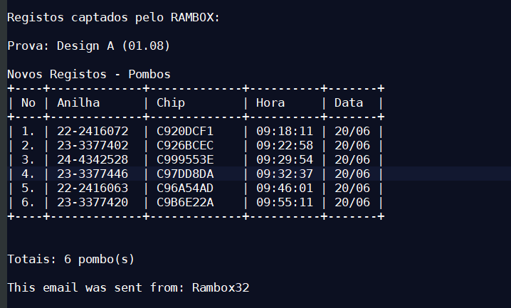
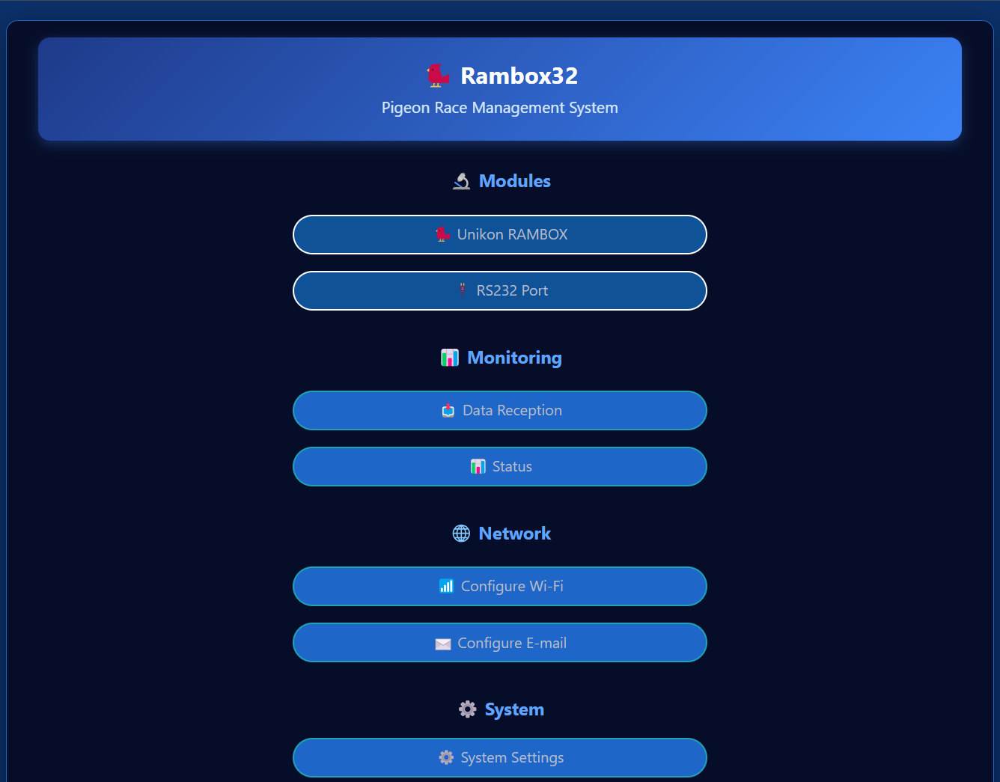

# Rambox32

**Pigeon-racing timing terminal firmware for ESP32-S3 N16R8** — part of the [Node32-HUB](https://github.com/nasp2000/Node32-HUB) project.

Connects to vintage pigeon-racing timing equipment over RS232 (9600 baud): **Unikon** clocks (**Champ** and **Profi**) and, as an **experimental** driver, **Bricon** loft modules. Email alerts, optional OLED display, OTA updates and a web-based control panel with live arrival monitoring.

> **One module at a time.** The firmware talks to either the Unikon clock or the Bricon loft module — never both. Selecting a module applies that module's RS232 profile automatically.

<table>
  <tr>
    <td width="50%"></td>
    <td width="50%"></td>
  </tr>
</table>

📷 [More screenshots](image/)

---

## Features

### Communication

**Unikon (stable)** — listens to the Unikon bus and logs everything it sees. Arrivals are detected via **polling**: the system continuously queries the clock and records new timestamps and ring numbers as they appear. Training/allocation writes are available but the clock is treated as **read-only by default** — a write is always explicit.

> **The fancier does not need to be at the loft** — as soon as a pigeon arrives, the system captures the data and sends an email alert automatically.

- **Arrivals** — pigeon arrival timestamps and ring numbers
- **Races** — race metadata
- **Loft** — loft configuration and bird registration data
- **Email alerts** — automatic notifications via SMTP TLS on new arrivals

**Bricon (experimental)** — loft-module driver rebuilt from a serial capture: `ActivateMaster`/`BA` scan, `GetFancier` → `GetPigeon` chain → `GetTimer`, `GetFlightNames` and `GetBandTable`.

> ⚠️ **Experimental:** the wire layer is implemented and covered by native tests, but it has **not been validated against real Bricon hardware** yet. Test it on a spare module before relying on it for a race.

### Web UI

- Unified **RAMBOX** page with a device selector (Unikon / Bricon) and live RS232 state
- Live RS232 data reception and transmission log
- Unikon terminal interface
- Machine status and event monitoring
- Email configuration and testing — HTML tables with computed column widths, so results stay aligned in any client
- OTA firmware updates
- LCD status display (OLED 0.96")

### Display (optional)
- **OLED screen** — real-time status dashboard showing clock, date, and recent pigeon arrivals. Not required for operation.

### Reliability
- Watchdog timer and crash recovery
- HTTP Basic Authentication for web access
- OTA updates for remote firmware upgrades
- NTP time synchronization

---

## Hardware Recommendation

- **ESP32-S3 N16R8** (any generic devkit with 8 MB PSRAM).
- **MAX3232** — RS232 transceiver for Unikon communication
- **OLED 0.96" (SSD1306)** — optional I2C display for real-time status
- RS232 Cable


### Wiring

```
ESP32-S3 N16R8          MAX3232                DB9 (Unikon)
─────────────────       ──────────             ─────────────
GPIO16 (UART2 RX)  ───  R1OUT (TTL out)
GPIO17 (UART2 TX)  ───  T1IN  (TTL in)
                    T1OUT ───────────────────  Pin 2 (TX)
                    R1IN  ───────────────────  Pin 3 (RX)
                    GND   ───────────────────  Pin 5 (GND)
                                               Pin 9 ───── Pin 5  ⚠️ jumper mandatory


ESP32-S3 N16R8          OLED SSD1306 (optional)
─────────────────       ───────────────────────
3.3V                ─── VCC
GND                 ─── GND
GPIO21 (I2C SDA)   ─── SDA
GPIO48 (I2C SCL)   ─── SCL
```

> **⚠️ Important:** The Unikon DB9 connector requires pins **9 and 5 to be jumpered** — the device will not communicate without this connection.

---

## Quick start

1. Flash the pre-built binary to your ESP32-S3 N16R8 (binaries in Releases) using [webflasher_Node32-HUB](https://github.com/nasp2000/webflasher_Node32-HUB). For future updates use **OTA** at `http://<esp32-ip>/ota`
2. Connect the timing equipment to the RS232 port (UART2, 9600 baud)
3. Open `http://rambox32.local` in a browser (mDNS) or `http://<esp32-ip>`
4. On the **RAMBOX** page, pick the timing module — **Unikon** (stable) or **Bricon** (experimental) — then configure WiFi and email in **Settings**

---

## First Access

1. Power up the ESP32 — it will boot in **Access Point (AP) mode**
2. Connect to the Wi-Fi network **`NODE32-HUB`** with password **`12345678`**
3. Open a browser and go to **`http://192.168.4.1`**
4. Log in to the web interface with:
   - **User:** `root`
   - **Password:** `root`
5. Go to **Settings → Wi-Fi** and connect the device to your local network
6. Once connected, the device is reachable at `http://rambox32.local` (mDNS) or the IP shown on the serial monitor (or OLED, if available) — use that from then on
7. **Configure email alerts** — go to **Settings → Email** and set up your SMTP server. This is essential: the Rambox32 sends email notifications when a pigeon arrives. Without email, arrivals are only visible on the web UI.

> The AP is disabled once the device stabilises on a Wi-Fi network (STA), keeping the radio focused on client traffic. If the device loses connection to the network, it reactivates AP mode automatically.

---

## License

Released under the MIT License — see [LICENSE](https://github.com/nasp2000/Node32-HUB/blob/main/LICENSE) in the main repository. This firmware links LGPL-2.1/LGPL-3.0 libraries; see [THIRD_PARTY_NOTICES](https://github.com/nasp2000/Node32-HUB/blob/main/THIRD_PARTY_NOTICES).
